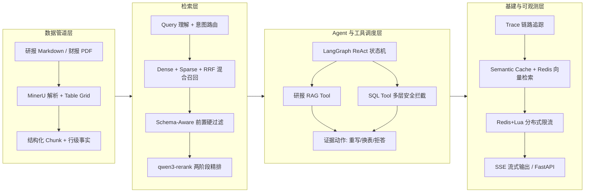

# 复杂表格 Agentic RAG：解析 → 检索 → Agent 证据治理 → 评测

> **30 秒速览**
> - **业务场景**：财务研报与财报的复杂表格 RAG，核心解决“表格被切碎”与“数字幻觉无法溯源”的痛点。
> - **硬核指标**：端到端 **P50 从 22.3s 降至 0.26s（提速 85.9 倍）**；表级 **Hit@10 达 87.5%**（MRR 提升至 0.7326）；Claim 支持率 **98.36%（120/122）**。
> - **架构亮点**：自研 Table Grid 解析、Schema-Aware 前置硬过滤、LangGraph 混合工具调度、Semantic Cache 降本增效、Redis 分布式基建。

本项目以结构保留解析、行级事实、混合检索、Agent 证据选择与 Claim 级评测构成闭环。不仅跑通了算法链路，还完成了服务化交付与高并发降本观测。

**技术栈**：Python · FastAPI (SSE) · LangGraph · Qdrant · Redis · Semantic Cache · Cross-Encoder · pytest (1086 单测)

[](https://github.com/autumnieave/table-evidence-rag/actions/workflows/ci.yml) []() [](LICENSE)

## 核心指标与工程收益

- **解析与表征**：受控 Gold Set TEDS 1.0（解决跨页/合并单元格），碎片 Chunk 减少 99.4%，建立 Cell-Level Anchors 支撑数字级溯源。
- **检索与重排**：针对跨期/跨公司噪声，引入 Schema-Aware 前置硬过滤与 Cross-Encoder 两阶段精排，表级 Hit@10 从 25% 提升至 87.5%，MRR@10 从 0.1292 提升至 0.7326。
- **降本与高并发**：引入 Semantic Cache 拦截重复 Query，免去昂贵的 LLM 生成 Token，端到端 P50 从 22.3s 降至 0.26s（提速 85.9 倍）；基于 Redis+Lua 实现分布式滑动窗口限流。
- **工程闭环**：基于 Docker Compose 一键编排交付；打通 SSE 流式输出（首字延迟从 38.3s 降至 0.674s）；配套 1086 条离线单测，CI 自动执行。

## 架构图



## 核心能力深度拆解

1. **数据解析与结构化**：
   - 自研 Table Grid 解析做跨页拼接与 Merged-Cell 语义恢复。
   - 引入 Parent Document 回拉机制，行级命中后向上拉取整表上下文，杜绝“表头丢失”。
2. **混合检索与过滤精排**：
   - 基线 Dense+Sparse+RRF 受噪声干扰严重，引入 Schema 实体与年份的强制过滤，大幅收敛候选池。
   - 线上用 qwen3-rerank 对 Top-50 结果重排，压住长尾干扰（消融实验基于 BGE-Reranker，见边界声明）。
3. **Agent 证据治理与状态路由**：
   - 基于 LangGraph 构建状态机，当数值口径（指标/期间/单位）不匹配时触发重写/拒答。
   - 引入 Intent Routing，将精确查数分发至带安全护栏的 SQL Tool，复杂推理走 RAG。
   - 引入 Targeted Retry（P50 388ms）替代全局盲搜。
4. **LLM 评测与 Faithfulness 纠偏**：
   - 搭建不合成单一分数的 RAG 四层评测矩阵（引用/答案/对抗/检索）。
   - 引入 Atomic Claim 分解与规则级证据定位，通过数值单位容差消除比对假阴性。严格核算 Claim 支持率达 98.36%（120/122）。
5. **高并发基建与降本观测**：
   - **Semantic Cache**：利用 Embedding 相似度在 Redis 中匹配同义 Query，命中后直接返回，免去 LLM 生成，速度提升 85.9 倍。
   - **状态外置**：将 LangGraph Checkpoint 由 SQLite 迁移至 Redis，支持多副本无状态扩展与断线重连。

## 快速开始

### 最短验证（零依赖离线单测）

```bash
pip install -r requirements.txt
python -m pytest tests/ -q    # 1086 个离线单测，无需 API Key / 数据库
```

### 完整服务运行

#### 1. 环境准备

```bash
python -m venv .venv && source .venv/bin/activate   # Windows: .venv\Scripts\activate
pip install -r requirements.txt
```

#### 2. 配置环境变量

复制 `.env.example` 为 `.env` 并填写：

```bash
DASHSCOPE_API_KEY=sk-xxx        # 阿里云百炼（必填）
MYSQL_HOST=127.0.0.1            # 可选：仅 Agent 的 SQL Tool 使用
```

#### 3. 一键编排启动（推荐）

项目提供了 `docker-compose.yml`，可一键启动 Qdrant + Redis + FastAPI 后端：

```bash
docker compose up -d --build
# 访问 API 文档：http://localhost:18000/docs
```

*(注：首次启动请确保在 `cli.py` 或 API 中触发过一次 `--build` 索引构建)*

## 测试与评估

```bash
# 运行全部单测 (1086 passed)
python -m pytest tests/ -q

# 运行评测闭环 (需本地 golden 数据支持)
python -m eval citation           # RAG-L1 引用核验
python -m eval challenge --run    # RAG-L3 对抗挑战集
```

## API 契约与 SSE 流式返回

后端对外只暴露两个问答入口：`POST /chat`（非流式）与 `POST /chat/stream`（SSE）。两者共用同一份请求模型，错误语义、意图路由与降级行为保持一致。

### 请求模型

`ChatRequest`（Pydantic，`mode` 为严格枚举）：

| 字段 | 类型 | 必填 | 默认值 | 说明 |
| --- | --- | --- | --- | --- |
| `question` | `string` | 是 | - | 用户问题原文 |
| `user_id` | `string` | 否 | `"default"` | 会话、限流、SSE 断点续传的隔离键 |
| `mode` | `Literal["rag", "agent"]` | 否 | `"rag"` | `rag`=研报 RAG；`agent`=LangGraph 多工具编排。其他值或 `null` 返回 422 |

`POST /chat` 的响应由 `ChatResponse` 约束：

| 字段 | 类型 | 说明 |
| --- | --- | --- |
| `content` | `string` | 最终答案（SQL 不可用时为结构化拒答话术） |
| `image` | `string[]` | 图表/图片地址 |
| `references` | `object[]` | 引用条目，含 `chunk_type`、`markdown`、`chunk_index`、`citation` 等 |
| `chart_json` | `object?` | ECharts 配置（仅财务查询可能返回） |
| `route_type` | `"financial" \| "research" \| "mixed"?` | 意图路由结果 |

> **详细的 API 契约、SSE 流式事件时序、错误降级机制以及断点续传实现，请参阅 [API_CONTRACT.md](docs/API_CONTRACT.md)。**

## 边界与 Trade-off 声明

1. **SQL Tool 定位**：SQL 是 Agent 的受控 Tool，主要用于精确查数。我们通过多层安全拦截与柔性审计确保安全，但不代表 SQL 返回结果 100% 业务正确。
2. **精排模型选择**：消融实验基于本地 BGE-Reranker，受限于单机内存；线上为了低延迟切换为云端 `qwen3-rerank` API，以保障吞吐与延迟。
3. **评测集性质**：24 题/22 题盲测集用于消融方向验证与指标纠偏，属于小样本，不作为统计学意义上的绝对泛化能力证明。
4. **缓存降级边界**：语义缓存采用内存 O(n) 余弦相似度匹配，在 <1000 条缓存时性能极佳（约 226ms 内），若大规模上生产将替换为 RediSearch 或专用向量索引。Checkpoint 强依赖 Redis Stack。
5. **MySQL 降级边界**：MySQL 缺失或凭据错误时，系统会自动拦截并返回结构化拒答（HTTP 200），不影响 RAG 主流程；SQL Tool 的失败不会升级为 500。

## License

MIT License，见 [LICENSE](LICENSE)。
