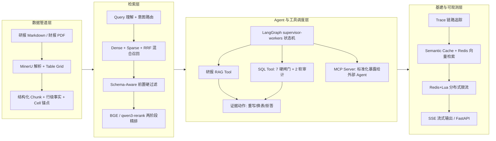

# 复杂表格 Agentic RAG：解析 → 检索 → Agent 证据治理 → 评测

> **30 秒速览**
> - **业务场景**：财务研报与财报的复杂表格 RAG，核心解决“表格被切碎”与“数字幻觉无法溯源”的痛点。
> - **硬核指标**：表级 **Hit@10 达 87.5%**（MRR 0.7326）；标准 TEDS 达 **0.994**；Claim 支持率 **97.32%（109/112）**。
> - **降本与并发**：端到端 P50 **20.5s → 13.2s**；缓存命中 **1.66s**；Locust 阶梯压测定位单机拐点（峰值 **161 QPS / 0 错误**）。
> - **架构亮点**：自研 Table Grid 解析、Schema 前置硬过滤、LangGraph 多 Agent 编排、MCP Server 标准化工具接入、Redis 分布式基建。

本项目以结构保留解析、行级事实、混合检索、Agent 证据选择与 Claim 级评测构成闭环。不仅跑通了算法链路，还完成了服务化交付与高并发降本观测。

**技术栈**：Python · FastAPI (SSE) · LangGraph · Qdrant · Redis Stack · Semantic Cache · Cross-Encoder · MCP · pytest (1101 单测)

[](https://github.com/autumnieave/table-evidence-rag/actions/workflows/ci.yml) []() [](LICENSE)

## 核心指标与工程收益

- **解析与表征**：受控边界集（10 表 / 142 行），标准 TEDS（基于 HTML 树编辑距离）达 **0.994**，碎片 Chunk 减少 99.4%，建立 Cell-Level Anchors 支撑数字级溯源。
- **检索与重排**：在 24 题受控消融集上，针对跨期噪声引入 Schema-Aware 前置硬过滤与 Cross-Encoder 精排，Hit@10 **25% → 75% → 87.5%**，MRR@10 从 0.1292 提升至 0.7326。
- **Agent 与 MCP 服务化**：LangGraph 多工具调度；SQL Tool 具备“7 道硬闸门 + 2 类柔性审计”；封装为 **MCP Server** 标准化暴露（不暴露原始 SQL，渐进式发现）。
- **降本与高并发**：Prompt 精简使端到端 P50 从 **20.5s 降至 13.2s**；Semantic Cache 命中耗时 **1.66s**；SSE 首字延迟 **3.3s**；Locust 压测定位容量拐点（**161 QPS，0 错误**）。

## 架构图



## 核心能力深度拆解

### 1. 数据解析与结构化

- 自研 Table Grid 解析做跨页拼接与 Merged-Cell 语义恢复。
- 引入 Parent Document 回拉机制，行级命中后向上拉取整表上下文，杜绝“表头丢失”。

### 2. 混合检索与过滤精排

- 基线 Dense+Sparse+RRF 受跨期噪声干扰严重（Hit@10 仅 25%），引入 Schema 实体与年份的强制过滤（升至 75%）。
- 服务化采用 qwen3-rerank 对 Top-50 结果重排，压住长尾干扰（消融实验基于 BGE-Reranker，见边界声明）。

### 3. Agent 证据治理与 MCP 协议

- LangGraph 状态机编排，当数值口径不匹配时触发重写/拒答，引入 Targeted Retry 替代全局盲搜。
- 独立 stdio MCP Server，将 RAG 与 SQL 能力标准化暴露；强制拦截原始 SQL，复用底层闸门，通过 `search_tools` 元工具实现渐进式发现。

### 4. LLM 评测与 Faithfulness 纠偏

- 搭建不合成单一分数的 RAG 四层评测矩阵。
- 构建“规则校验 + LLM-as-Judge”混合评测，强化实体比对，严格核算 Claim 支持率达 97.32%（109/112）。

### 5. 高并发基建与降本观测

- **降本策略**：通过 Prompt 约束精简输出（P50 20.5s → 13.2s），配合 Semantic Cache（命中 1.66s）与 SSE 流式输出（首字 3.3s）。
- **缓存防误命中**：Cache 配有实体与期间强校验，已验证不同指标/期间/公司互不误命中（反向负样本 3/3，阈值 0.92）。
- **容量验证**：基于 Redis+Lua 限流，Locust 阶梯压测确认单机容量拐点（20 并发 / 161 QPS，全程 0 错误、0 超时）。

## 快速开始

### 最短验证（零依赖离线单测）

```bash
pip install -r requirements.txt
python -m pytest tests/ -q    # 1101 passed, 0 skipped；无需 API Key / 数据库
```

### 完整服务运行

#### 1. 环境准备

```bash
python -m venv .venv && source .venv/bin/activate   # Windows: .venv\Scripts\activate
pip install -r requirements.txt
```

#### 2. 配置环境变量

复制 `.env.example` 为 `.env` 并填写：

```bash
DASHSCOPE_API_KEY=sk-xxx        # 阿里云百炼（必填）
MYSQL_HOST=127.0.0.1            # 可选：仅 Agent 的 SQL Tool 使用
```

#### 3. 一键编排启动（推荐）

项目提供了 `docker-compose.yml`，可一键启动 Qdrant + Redis Stack + FastAPI 后端：

```bash
docker compose up -d --build
# 访问 API 文档：http://localhost:18000/docs
```

> 注：首次启动请确保在 `cli.py` 或 API 中触发过一次 `--build` 索引构建。

## 测试与评估

```bash
# 运行全部单测（1101 passed, 0 skipped）
python -m pytest tests/ -q

# 运行评测闭环（需本地 golden 数据支持）
python -m eval citation           # RAG-L1 引用核验
python -m eval challenge --run    # RAG-L3 对抗挑战集
```

## API 契约与 SSE 流式返回

后端对外暴露 `POST /chat` 与 `POST /chat/stream`（SSE）。两者共用同一份请求模型，错误语义、意图路由与降级行为保持一致。

- 请求模型：`question`（必填）、`user_id`（默认 `default`）、`mode`（`Literal["rag", "agent"]`）。
- 响应模型：包含 `content`、`references`（含 Markdown 表格与 `chunk_index`）、`route_type` 等。
- 详细的 API 契约、SSE 事件时序、错误分级机制与断点续传实现，请参阅 [API_CONTRACT.md](docs/API_CONTRACT.md)。

## MCP Server 接入指南

本项目额外提供独立的 stdio MCP Server，将“研报检索”与“受控财务查数”标准化暴露给外部 Agent（如 Cursor / Claude Desktop）。

### 暴露的工具

| 工具 | 用途 | 风险等级 |
| --- | --- | --- |
| `search_financial_reports` | 复用 RAGPipeline 检索研报与引用 | 只读研究 |
| `query_financial_data` | 自然语言查数，强制走既有 SQL 闸门 | high (executes SQL) |
| `search_tools` | 基于关键词做渐进式工具发现 | 元工具 |

### 安全边界

- MCP 标准化了调用协议，但安全策略依然由本 Server 内部的 SQL 闸门强制接管。
- MCP 入口不接收原始 SQL，底层返回的 SQL 还会经过 `validate_sql_output` 与 `enforce_select_limit` 二次校验。
- 异常统一映射为结构化 JSON（`SecurityValidationError` / `NetworkTimeout` / `InternalError`），绝不抛出 Python traceback。

### 启动与配置

```bash
# Windows PowerShell
$env:PYTHONPATH = (Resolve-Path .\src)
.\.venv\Scripts\python -m mcp_server
```

Cursor / Claude Desktop 配置示例：在 `mcp.json` 中配置 `command` 指向本机 `.venv` 的 Python，`args` 为 `["-m", "mcp_server"]`，并注入环境变量。

## 边界与 Trade-off 声明

- **SQL Tool 定位**：SQL 是 Agent 的受控 Tool，我们通过多层安全拦截与柔性审计确保过程安全，但不代表 SQL 返回结果 100% 业务正确。
- **精排模型选择**：消融实验基于本地 BGE-Reranker；线上为了低延迟切换为云端 qwen3-rerank API。
- **评测集性质**：24 题盲测集用于消融方向验证与指标纠偏，属于小样本受控评测，不作为绝对泛化能力证明。
- **缓存降级边界**：语义缓存采用内存余弦相似度匹配，若大规模生产将替换为 RediSearch。Checkpoint 强依赖 Redis Stack。
- **压测边界**：Locust 压测数据基于精确缓存命中路径，代表本地服务层与缓存链路的容量，不代表端到端大模型生成的吞吐极限。

## License

MIT License，见 [LICENSE](LICENSE)。
